# Sid All FPS Game — 壓槍腳本

適用於 FPS 遊戲的壓槍輔助工具。v1.2.0 為 C#（WPF）重寫版，具有全新 Fluent 介面（深色／淺色主題、五大分頁），操作體驗與上一版一致，舊有設定可直接沿用。

> ⚠️ 此版本庫僅用於 **發佈 Release（執行檔下載）**。原始碼存放於私人版本庫。

---

## ✨ 功能特色

- 🎨 **全新 Fluent 介面**：深色／淺色主題切換，五大分頁一目瞭然
- 📦 **9 槽槍械預設**：獨立保存槍械壓槍力道與間隔，快速存/載
- ⚡ **即時微調**：遊戲中用熱鍵調整力度與間隔，不必跳出視窗
- 🎯 **準星覆蓋**：螢幕十字準星，可切換顯示與顏色
- 🎮 **目標視窗鎖定**：只對指定遊戲生效，避免誤觸其他視窗
- 🔄 **自動更新檢查**：啟動 5 秒後自動檢查，有新版只在頁內顯示、不彈窗
- ⌨️ **完整鍵盤導航**：支援小鍵盤與短鍵盤兩種排佈

---

## 📸 介面預覽

### 深色主題

| 基本設定 | 槍械管理 |
| --- | --- |
| [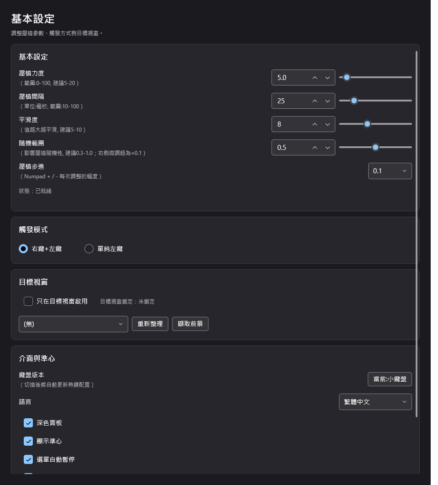](docs/screenshots/basic-dark.png) | [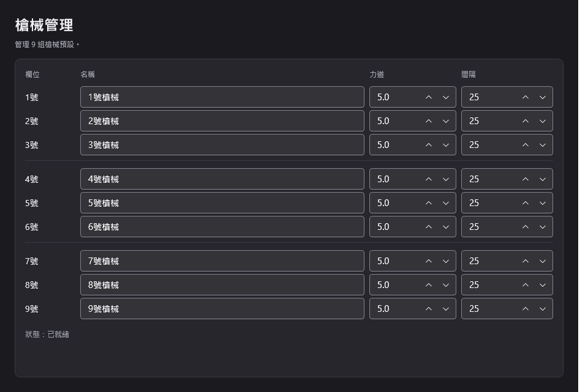](docs/screenshots/weapon-dark.png) |

| 熱鍵設定 | 說明 |
| --- | --- |
| [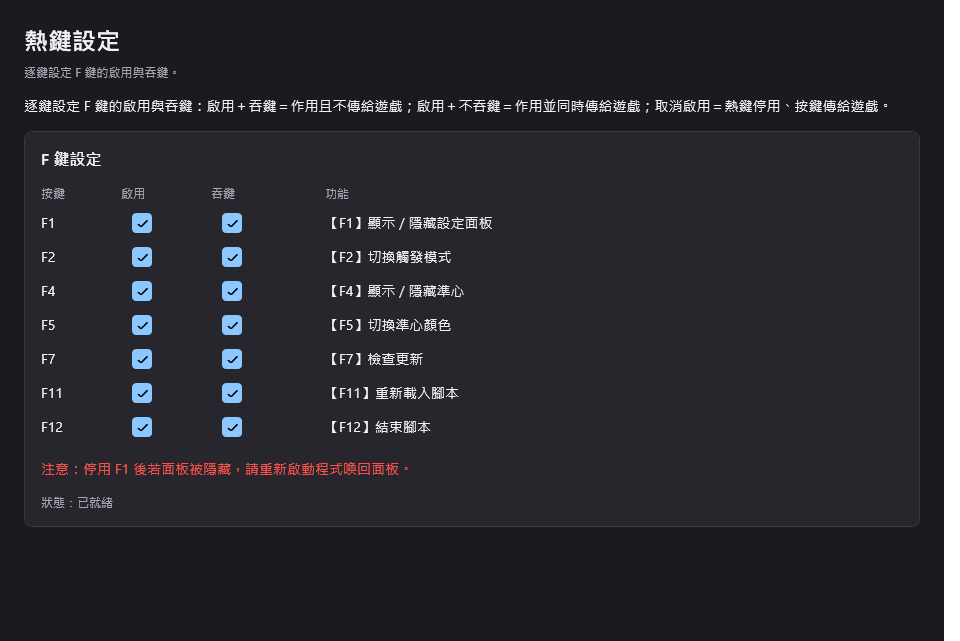](docs/screenshots/hotkeys-dark.png) | [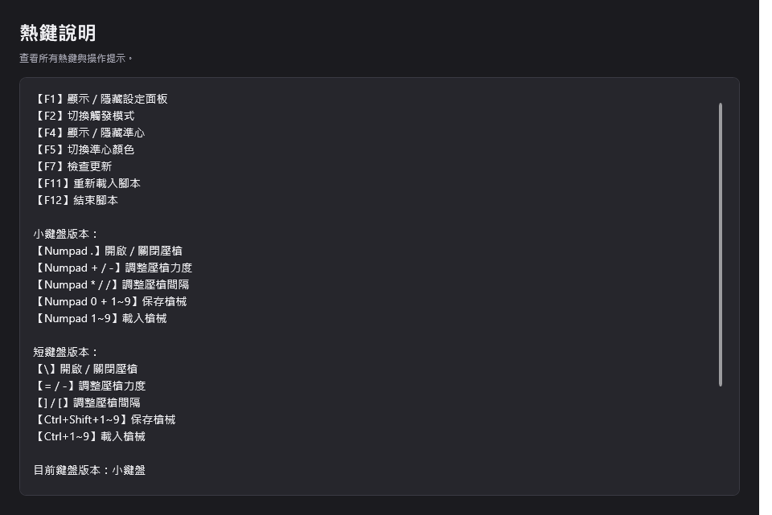](docs/screenshots/help-dark.png) |

| 更新 | 主視窗（深色） |
| --- | --- |
| [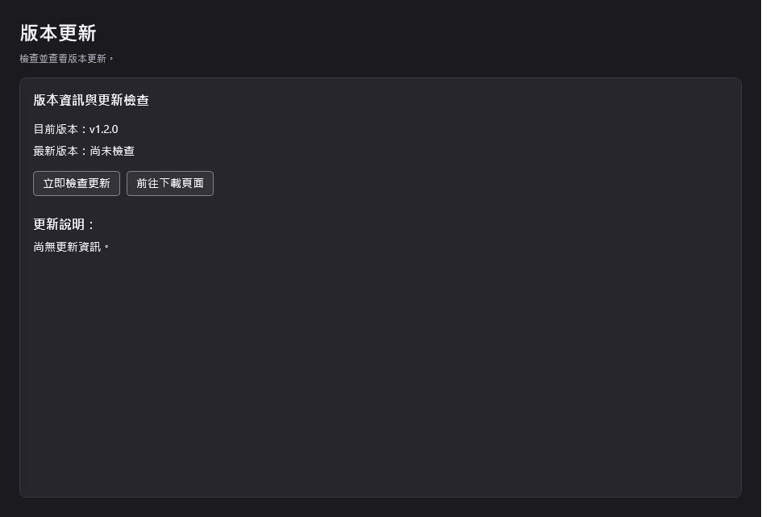](docs/screenshots/update-dark.png) | [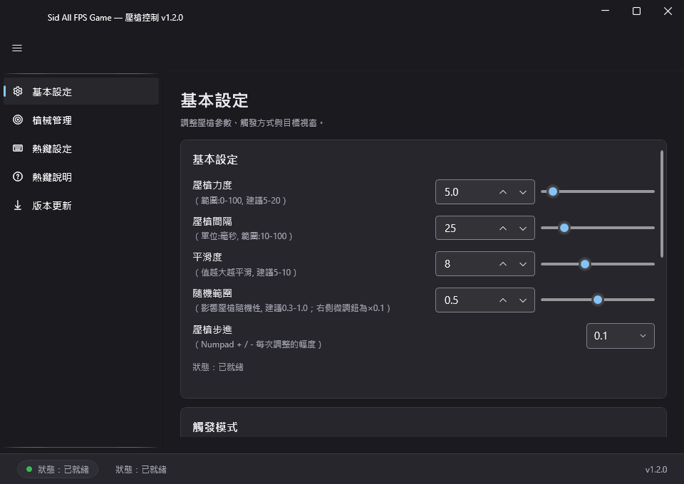](docs/screenshots/basic-dark-680.png) |

### 淺色主題對照

| 基本設定 | 槍械管理 |
| --- | --- |
| [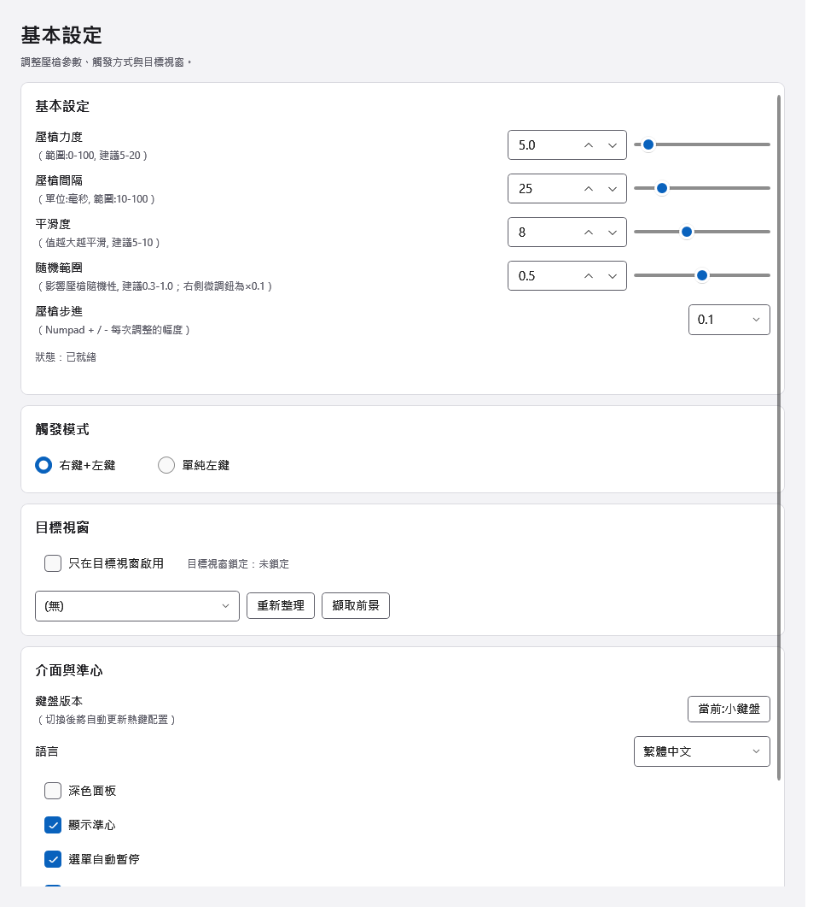](docs/screenshots/basic-light.png) | [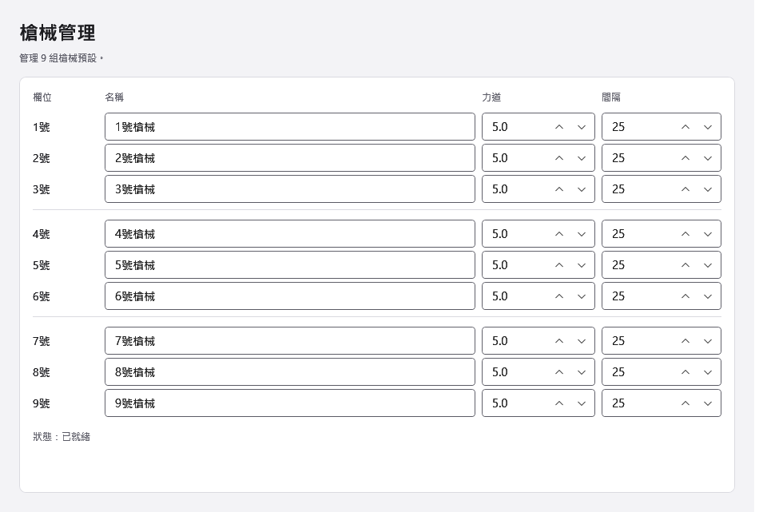](docs/screenshots/weapon-light.png) |

| 熱鍵設定 | 說明 |
| --- | --- |
| [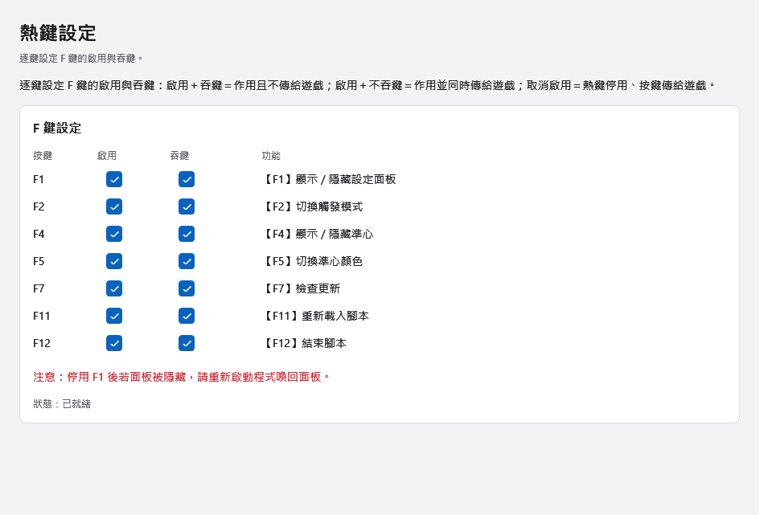](docs/screenshots/hotkeys-light.png) | [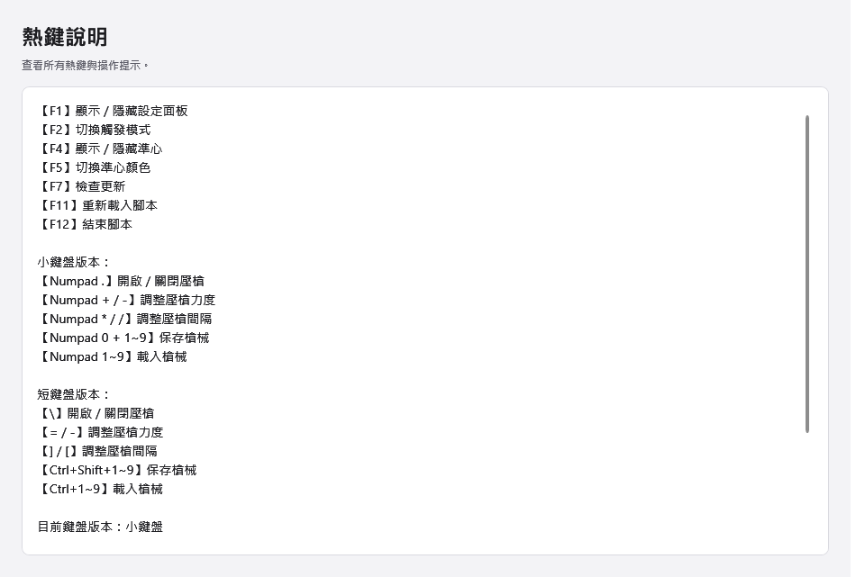](docs/screenshots/help-light.png) |

| 更新 | 主視窗（淺色） |
| --- | --- |
| [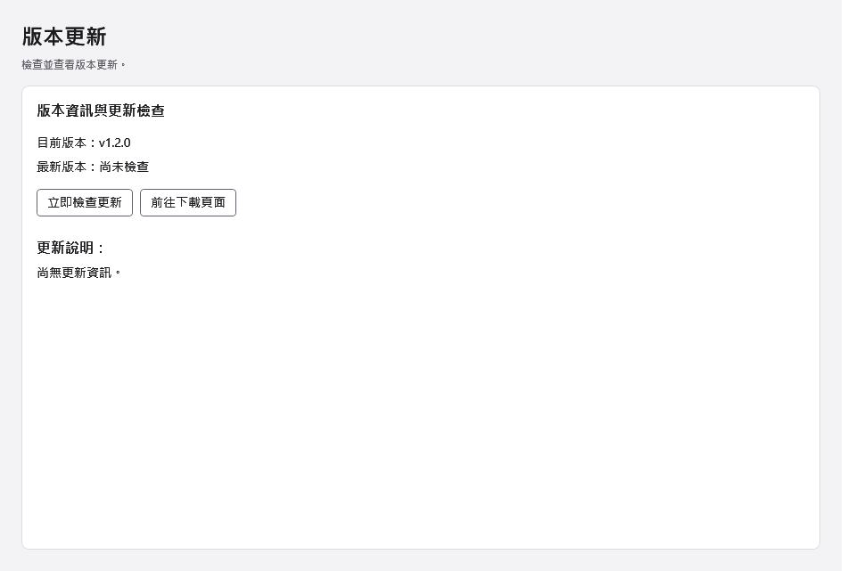](docs/screenshots/update-light.png) | [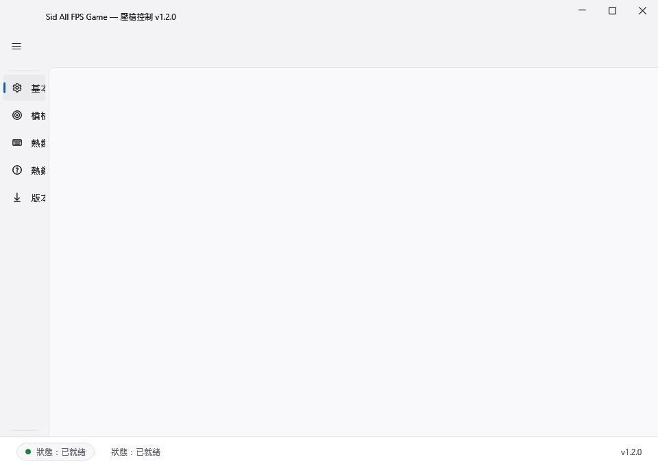](docs/screenshots/basic-light-680.png) |

---

## 📥 下載

請至 [Releases 頁面](https://github.com/Sid-1996/Sid-gun/releases) 下載：正式版 `SidAllFPS-v1.2.0.zip`；試用版（14 天免費試用，限 3 組槍械預設）請至 [v1.2.1-trial](https://github.com/Sid-1996/Sid-gun/releases/tag/v1.2.1-trial) 下載 `SidAllFPS.Trial-v1.2.1.zip`。

## 💻 系統需求

- Windows 10 / 11 x64
- 首次執行需要系統管理員權限（UAC 提示）
- 首次執行時若出現「You must install or update .NET」提示，點提示內的下載連結，安裝 .NET 10 Desktop Runtime (x64) 後再執行一次即可

## 🔧 安裝

1. 將 `SidAllFPS-v1.2.0.zip` 解壓縮到固定資料夾（例如 `C:\SidAllFPS`）。
2. 執行 `SidAllFPS.Wpf.exe`（試用版為 `SidAllFPS.Trial.exe`）。
3. 設定檔會自動建立在同資料夾下的 `config\設置.ini`；舊版 AHK 產生的 `設置.ini` 可直接沿用。

## 🔄 更新

啟動約 5 秒後會自動檢查更新，有新版時只在「更新」頁面內顯示、不會彈窗；也可以隨時在「更新」頁面手動檢查。

## 📄 授權

MIT License
